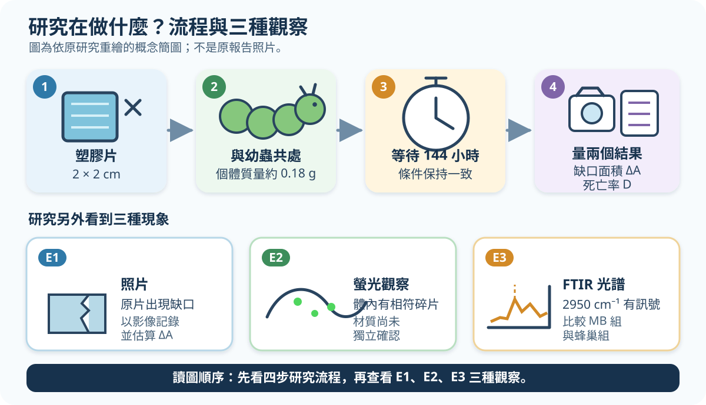

# 今日一題｜塑膠少了，就是被分解了嗎？

> 高一自然科／探究與實作｜建議 8–12 分鐘｜共 6 分｜可使用計算機

本題改編自第 65 屆全國中小學科學展覽會作品〈蟲塑未來—探討小蠟蛾幼蟲攝食塑膠之研究〉；作答不需另讀原報告。[1][4]



*圖 1　依原研究重繪的概念簡圖；不是原報告照片。*

表中的 `ΔA` 與非零死亡率在來源中以「約」呈現。本題直接使用下表數字，並把初始面積題定為 `A₀ = 4.00 cm²`。

| 材料 | `ΔA`（cm²） | 死亡率 `D` |
|---|---:|---:|
| MB（口罩過濾層） | 1.23 | 40% |
| EP（口罩內層） | 0.42 | 0% |
| HDPE（塑膠袋） | 0.56 | 20% |
| LLDPE+HDPE（垃圾袋） | 0.54 | 0% |

```text
R = ΔA ÷ A₀ × 100%
```

`R` 取到 0.1%。選材規則：**先排除 `D > 10%`，再從合格材料中選 `R` 最大者。**

判讀用語：

- **物理碎裂**：塑膠變小，但長鏈未必斷裂。
- **化學分解**：須有長鏈斷裂的化學證據，例如平均分子量降低或出現可確認的新小分子。
- **完全且無害**：還須交代全部物質去向及是否造成危害。
- **FTIR**：用紅外吸收特徵推測分子鍵的方法。

待評鑑主張 `C`：「MB 的減少面積最大，所以幼蟲已把 MB 完全化學分解成無害物質。」

## 問題

### （一）計算後依規則決策（2 分）

1. 列出所有合格材料（0.5 分）。
2. **只替合格材料**算 `R`，依表格順序列出（各 0.5 分，共 1 分）。
3. 選出 1 種材料，並引用它的 `D` 與 `R` 說明（0.5 分）。

### （二）觀察能支持什麼？（2 分）

**1. 針對主張 `C`，下列哪個判讀最嚴謹？單選。（1 分）**

- **(A)** E1 已證明所有缺少的塑膠都進入幼蟲體內。
- **(B)** E2 已證明聚合物長鏈在幼蟲體內斷裂。
- **(C)** E1 可由脫落／碎裂解釋；E2 即使是塑膠，也可能是未斷鏈碎片，所以兩者都不能單獨證明化學分解。
- **(D)** E1、E2 合起來已證明產物完全且無害。

**2.** E3 的 `2950 cm⁻¹` 訊號還可能來自什麼？提出 1 個替代來源（0.5 分）。再提出 1 個無害性測試，寫出「測量結果」與「比較對象」（0.5 分）。

### （三）判讀命題改編的確認性實驗（2 分）

以下是假想實驗，**不是原科展已做過的程序**。`失活基質`是同批萃取液加熱後使候選酵素失去活性；`載液`是溶解酵素的液體。三組使用同批 MB、相同條件並獨立重複；差異大於量測不確定度。

| 組別 | 處理 | 小碎片 | 平均分子量（初始＝100%） | MB 來源新小分子 |
|---|---|---|---:|---|
| A | 失活基質＋載液＋活性候選酵素 | 增加 | 62% | 檢出 |
| B | 失活基質＋載液 | 無明顯增加 | 99% | 未檢出 |
| C | 緩衝液 | 無明顯增加 | 100% | 未檢出 |

1. 為何判斷酵素效應時應主要比較 A 與 B，而不能只比 A 與 C？再用兩個**化學欄位**寫出因果結論（1 分）。
2. 另一實驗只有「小碎片增加、可回收固體質量下降」，但兩個化學欄位都和對照相同；回收量只計 `≥ 5 μm` 固體，未計 `< 5 μm` 顆粒。這是否支持「長鏈已斷裂」？請引用兩欄說明。為何質量下降仍不能單獨證明化學分解？（1 分）

## 作答與安全

- 第（一）若算錯，但後續一致套用規則，仍可給方法分。
- 本題只做紙筆判讀；延伸實作須由合格實驗室操作，含塑膠碎片液體不得排入水槽。

## Sources

[1] https://twsf.ntsec.gov.tw/activity/race-1/65/senior.html — 第65屆高級中等學校組

[4] https://twsf.ntsec.gov.tw/activity/race-1/65/pdf/NPHSF2025-052016.pdf — 蟲塑未來—探討小蠟蛾幼蟲攝食塑膠之研究
